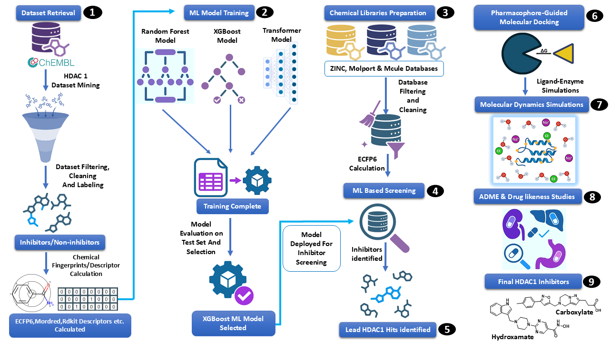

# Machine Learning and Cheminformatics-Driven Identification of Potential Histone Deacetylase 1 Inhibitor Candidates

[](https://opensource.org/licenses/MIT)
[](https://colab.research.google.com/)
[](https://www.kaggle.com/)

An integrated *in silico* pipeline for HDAC1-targeted drug discovery. It leverages machine learning to filter large-scale chemical libraries, followed by molecular docking and MD simulations to assess 3D structural complementarity. This merges AI-driven enrichment with biophysical modeling to identify diverse lead scaffolds.



##  Project Overview
This repository contains the datasets and Google Colab notebooks for our hybrid machine learning and cheminformatics workflow. By systematically coupling interpretable AI with rigorous molecular modeling, this pipeline identifies structurally novel candidate scaffolds capable of targeting the Histone Deacetylase 1 (HDAC1) active site.

**Key Pipeline Stages:**
* **Data Curation & Scaffold Splitting:** Rigorous model evaluation utilizing Bemis-Murcko scaffold splitting to ensure robust chemical-space generalization and Applicability Domain (AD) profiling.
* **Machine Learning Classification:** High-throughput virtual screening of million-scale databases using ECFP6-trained XGBoost and Random Forest algorithms.
* **SHAP Feature Interpretability:** Mapping algorithmic predictive weights to canonical Cap-Linker-ZBG pharmacophore requirements to explain the ML model "black-box" decision-making process.
* **Biophysical Prioritization:** Assessing the spatial fit, thermodynamic stability, and dynamic behavior of prioritized hits via Molecular Docking, 200 ns Molecular Dynamics (MD), and MM-PBSA calculations.

##  Repository Structure

```text
├── Datasets/
│   └── HDAC1_dataset.csv                                     # Cleaned and processed dataset of HDAC1 inhibitors
├── images/
│   └── Abstract.png                                          # Graphical abstract of the workflow
├── Dataset_train_test_Splitting_code.ipynb                   # Bemis-Murcko and random train/test split implementations
├── ecfp6-fingerprint-generation.ipynb                        # Generation of 2048-bit ECFP6 representations using RDKit
├── random_forest_model_hdac1_training_workflow.ipynb         # RF model training, optimization, and evaluation
└── xgboost_hdac1_training and screening pipeline.ipynb       # XGBoost model training, SHAP analysis, and virtual screening
